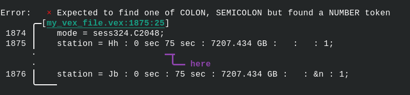

# `vexio`
`vexio` is a library for parsing, modifying, and creating Very Long Baseline Interferometry (VLBI) Experiment files, or VEX files, commonly used for describing radio astronomy VLBI experiments.

## About Vex
Vex files are (loosely) defined by the [VEX Spec](https://vlbi.org/vlbi-standards/vex/), and contain textual information that looks a bit like this:
```
$EXPER;
def ME600;
    exper_name = ME600;
    exper_description = "A really cool experiment";
    exper_nominal_start = 2026y002d12h00m00s;
    exper_nominal_stop = 2026y002d16h00m00s;
    PI_name = "Bloggs, Joe";
    PI_email = some@totally_real_email.com;
    target_correlator = e-MERLIN;
enddef;
```

The intent of the file is to comprehensively document and describe a particular experiment in an observatory-agnostic way. This makes it easier for observatories to cooperate since they are working from a mutually understood observation plan. And, when the observation is done, the Vex file can be archived so that both observatories can document a complete history of their observations.

## `vexio` features

This library seeks to solve many of the historical problems of using Vex by providing a premium experience for users of Vex in radio astronomy (like myself). 

### Error Messages!

First and foremost, `vexio` provides a detailed error message when things go wrong in your Vex file - no more searching through hundreds of lines to find the missing colon! Thanks to [`miette`](https://github.com/zkat/miette), `vexio` can provide awesome error messages that tell you exactly how you messed up your experiment file:



The `Diagnostic` trait provided by `miette` is implemented only when the `miette` feature of `vexio` is enabled (which is _disabled_ by default).

### Convenient Construction

`vexio` provides some handy macros for constructing Vex components, like constructing a `def` block:
```rust
let param_name = "my_parameter".to_string();
let num = 64;
let mydef = def!("my_def_block";
    "{param_name}" = "value" : "{num}";
    "param2" = "&my_link" : "64 TB";
);

// Equivalent to:
// def my_def_block;
//      my_parameter = value : 64;
//      param2 = &my_link : 64 TB;
// enddef;
```

Or a `ref` declaration:
```rust
let refr = refr!("MYBLOCK" = "keyword" : "qual1" : "qual2");

// Equivalent to:
// ref $MYBLOCK = keyword : qual1 : qual2;
```

### Permissive Parsing
`vexio` does not take an opinion on whether your vex file contains valid Vex, only that it is written using Vex syntax. This may change in the future, but for now it seems that the Vex specification (outside of the syntax) is only loosely enforced, so the software follows this trend. For you, this means that you can create an entirely new undefined primitive block and write your Vex file normally. You can then send this to someone else using `vexio` which will parse that undefined block as a normal primitive block.

### Python bindings
Python bindings to `vexio` can be found under [`py/`](./py)

## Contributing

### Testing
There's a huge variety of Vex files out there. Some abide by the specification, some don't, so there's likely some corner cases where errors occur but shouldn't. If you have a Vex file that `vexio` isn't happy with but you're sure is valid, please submit an issue or send me the Vex file directly so I can check it myself. I can include it in the [integration tests](./tests) to ensure `vexio` will always parse it correctly.

### New Features
If you have suggestions on new features you'd like to see in `vexio`, please let me know by opening a Github issue. Or you can implement it yourself by submitting a pull request.
